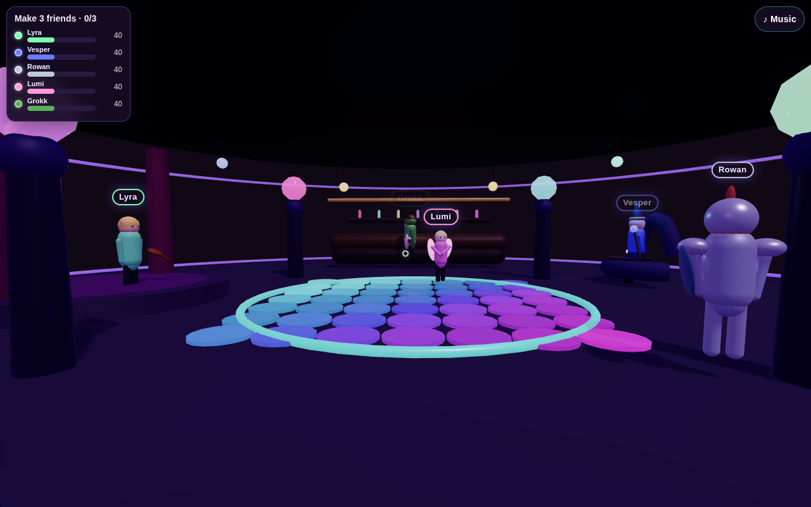
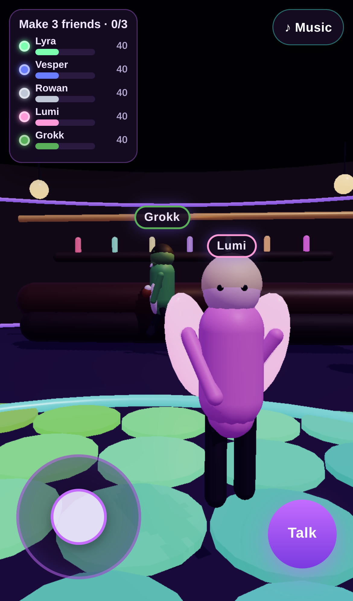

# Moonveil Club

A fantasy first-person social browser game prototype. Wander a glowing lounge with a dance floor, bar, and stage, and make friends with the regulars: Lyra the elf bard, Vesper the wizard, Rowan the knight, Lumi the fairy, and Grokk the orc bartender.

Open the folder over HTTP (a local web server or GitHub Pages) and visit `index.html` in a modern browser, including iPhone Safari. The characters are local glTF files in `assets/`, so the page has to be served — opening it as a `file://` URL cannot load them.

## Characters

The bodies in the repo today are slim adult anime bases from the VRoid Project, CC0, about 11,000 triangles each, with textures small enough that `female.glb` and `male.glb` stay under a megabyte. Robes, sleeves, sashes, and the three hairstyles are built on that skeleton so one base can take any color. Desktop quality uses a denser cloth and hair mesh. The Low graphics preset keeps a lighter version of the same clothes.

A later character set can replace those bases without a code change. Put the files at:

- `assets/characters/high/female.glb` and `male.glb` — about 40–70k triangles, 2K textures, used for Medium and High
- `assets/characters/lite/female.glb` and `male.glb` — about 15–20k triangles, used for Low

Then set `"high": true` and/or `"lite": true` in `assets/characters/manifest.json`. Until a flag is true, the game keeps using the CC0 bases above. Both tiers should use the VRoid `J_Bip_*` bones, materials whose names contain `SKIN`, `HAIR`, `ROBE`, or `ACCENT` (the game tints those to the chosen colors), and clips named `Idle`, `Walking_A`, and `Dance`. If those clips are present they play instead of the built-in ones. If `ROBE` or `HAIR` materials are present, the procedural robe or hair is left off.

Idle, walk, and dance crossfade with an `AnimationMixer`. Materials use toon shading, with a warm fill and a cool rim in the club.

| Regular | Read |
| --- | --- |
| Lyra | Jade-robed bard, long dark hair, hairpin |
| Vesper | Star scholar, topknot, deep blue robe, crown |
| Rowan | Sword cultivator, pale robe, blade at the back |
| Lumi | Moon priestess, pink robe, bun |
| Grokk | Hearth keeper, green robe, topknot |

A moon gate stands on the left of the lounge. Older saves still load: `short` hair becomes a bun, `tied` becomes a topknot, and the old outfit color is used as the robe color.

## Credits and licenses

**VRoid base models** (`Base_Female`, `Base_Male`) by the VRoid Project (pixiv). The copies here are the CC0 exports documented at [VRoid's sample-model terms](https://vroid.pixiv.help/hc/en-us/articles/4402614652569) and mirrored on [OpenGameArt](https://opengameart.org/content/vroid-studio-cc0-models). License: **CC0 1.0**. A note is in `assets/licenses/vroid-cc0.txt`.

The earlier KayKit Adventurers pack (also CC0, Kay Lousberg) is no longer used for the characters. Its license note remains at `assets/licenses/kaykit-adventurers-CC0.txt`.

## Menus

The title screen has New Game, Continue (only after a save), Sign In, Settings, Credits, and Quit. New Game asks for an account first: username and password, email optional, or sign in, or skip and play as a guest. Character creation comes next, then the club. Esc opens the pause menu (Resume, Save, Settings, Main Menu). On a phone, use the Pause button. Menu screens fade in.

## You

Character creation is male or female, on the same bases as the regulars. Pick a name, skin tone, hair style (long, topknot, or bun), hair color, robe color, accent, and a hairpin, crown, or sword. The preview turns and frames the whole figure. In the club, look down to see your body and shadow. Press **V** for a third-person view. The regulars use your name when they talk.

## Saves and settings

Saves are version 1 JSON in `localStorage`, one per signed-in account (guests have their own slot). They store your character, position and look direction, each regular's friendship and whether you have talked, the win flag, and settings. The game autosaves, and pause has a Save button. Continue loads that save.

Settings cover render scale (50–100%), a device pixel-ratio cap, desktop resolution presets, Low/Medium/High graphics (fog, shadow map, and how many lights stay on), shadows, field of view, mouse and touch look sensitivity, invert Y, master/music/effects volume, an FPS counter, and fullscreen where the browser allows it.

## Accounts

There is no server. Sign-in goes through a small auth interface with a local adapter: accounts live in `localStorage`, and passwords are stored only as a SHA-256 hash plus a random salt (WebCrypto). A Firebase or Supabase adapter can replace `localAuth` later. The game only calls `signUp`, `signIn`, `signOut`, and `current`.

## Desktop controls

- Move with **WASD** or the arrow keys
- Click to lock the cursor, then look around with the mouse
- Press **E** when you are near someone to talk
- Choose a reply with **1**–**3** or a click; **Esc** pauses, or closes a chat
- Press **V** to toggle third person
- Press **M** to toggle the club beat

## Touch controls (iPhone and other phones)

- Walk with the left joystick
- Drag on the right side of the screen to look around
- When you are close to someone, tap **Talk**
- Tap a reply, or **Close** to leave the conversation
- Tap **Pause** for the pause menu
- Tap **♪ Music** for a beat (after you start)

Goal: talk, dance, and make three friends.
